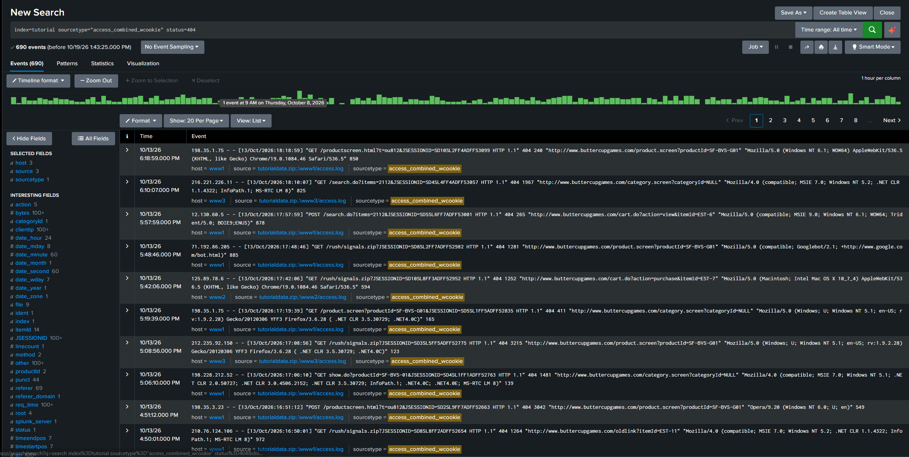
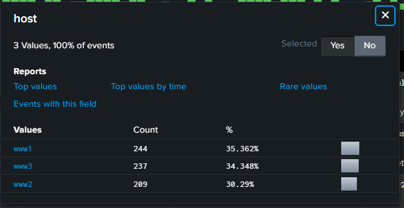
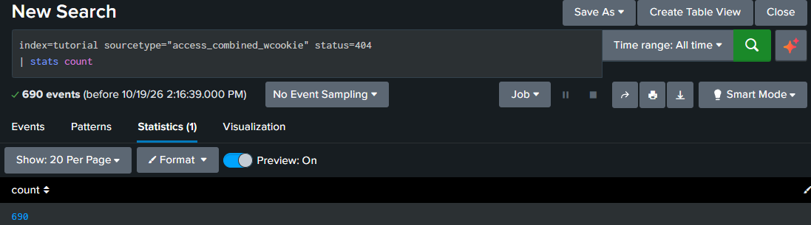

# 🔍 Search Practice

My hands-on SPL practice using Splunk's Search Tutorial data. When conducting each search I wrote down the prediction **before** running it, then compared it to the actual generated results. 

## Search 1: Finding web errors

```spl
index=tutorial sourcetype=access_combined_wcookie status=404
```
  - **Prediction:** Only the web servers will appear, based on two clues: the sourcetype `access_combined_wcookie` is web server traffic, and `404` is a web status code, which the mail server's login records don't use.
    
- **Results:** I was correct. The results returned 690 events split among the 3 web servers: www1 (244), www3 (237), and www2 (209).
  
  
  
- **What I learned:** Combining a sourcetype field with a status code narrows the search and allows you to look for specific events. Based on the results, the even split suggests a load balancer is spreading traffic across the three web servers.  

  

## Search 2: Counting the errors

```spl
index=tutorial sourcetype=access_combined_wcookie status=404 | stats count
```

- **Prediction:** 690 rows, 1 column named `count`, showing 690.
- **Results:** Partly correct. The column name and number were right, but there was only **1 row**, not 690.


  
- **What I learned:** `stats` makes one row per *group*, not one row per *event*. With no `by` clause, all 690 events form a single group, so the result is one row. Transforming commands like `stats` show their results on the Statistics tab instead of the Events tab.

## Search 3: Counting by status code

```spl
index=tutorial sourcetype=access_combined_wcookie | stats count by status
```

- **Prediction:** 1 column named `status` and 1 row.
- **First attempt (my mistake):** I only got one row: `404` with 690. I had edited Search 2 and left `status=404` in front of the pipe, so only 404 events ever reached `stats`.
- **Results after the fix:** 2 columns (`status` and `count`) and 9 rows, one per status code. `200` had the highest count (34,282), and `404` still showed 690, matching Searches 1 and 2. The rows were sorted from lowest to highest status code.
- **What I learned:** The `by` field becomes its own column, and each different value gets its own row. Anything filtered out before the pipe never reaches `stats`. The results also give a baseline: roughly one "page not found" for every 50 successful requests.
