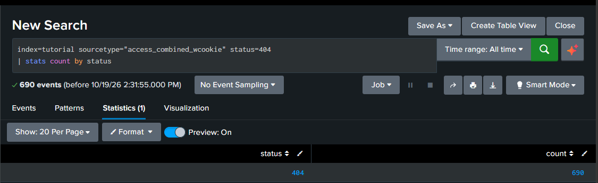
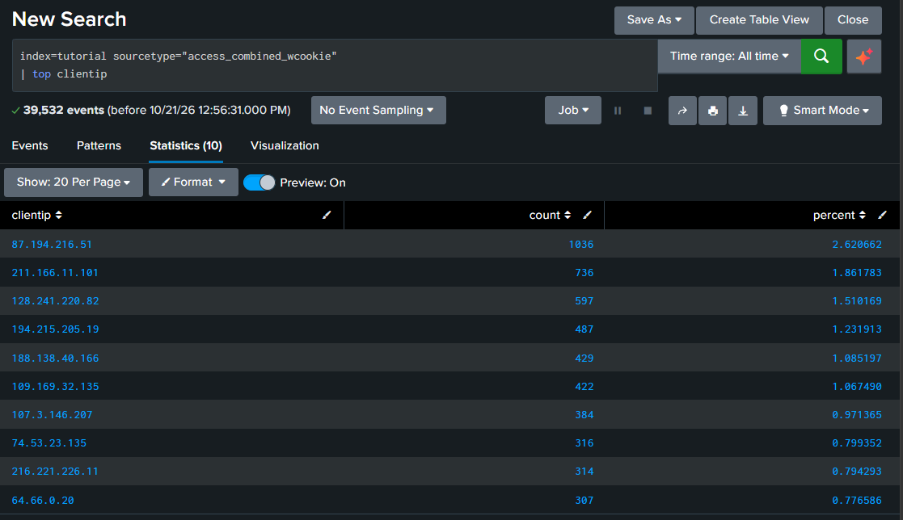
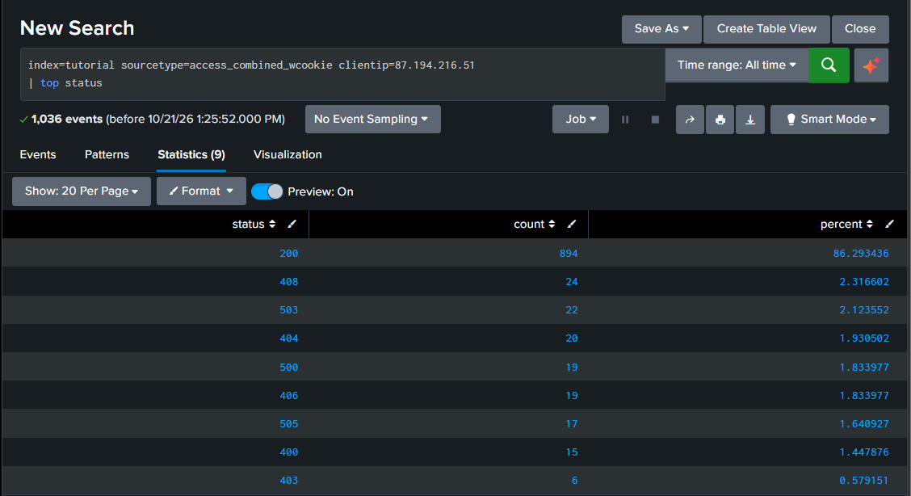

# 🔍 Search Practice

My hands-on SPL practice using Splunk's Search Tutorial data. When conducting each search I wrote down the prediction **before** running it, then compared it to the actual generated results. 

## Search 1: Finding web errors

```spl
index=tutorial sourcetype=access_combined_wcookie status=404
```
  - **Prediction:** Only the web servers will appear, based on two clues: the sourcetype `access_combined_wcookie` is web server traffic, and `404` is a web status code, which the mail server's login records don't use.
    
- **Results:** I was correct. The results returned 690 events split among the 3 web servers: www1 (244), www3 (237), and www2 (209).
  
  
  
- **What I learned:** Combining a sourcetype field with a status code narrows the search and allows you to look for specific events. Based on the results, the even split suggests a load balancer is spreading traffic across the three web servers.  

  

## Search 2: Counting the errors

```spl
index=tutorial sourcetype=access_combined_wcookie status=404 | stats count
```

- **Prediction:** 690 rows, 1 column named `count`, showing 690.
- **Results:** Partly correct. The column name and number were right, but there was only **1 row**, not 690.


  
- **What I learned:** `stats` makes one row per *group*, not one row per *event*. With no `by` clause, all 690 events form a single group, so the result is one row. Transforming commands like `stats` show their results on the Statistics tab instead of the Events tab.

## Search 3: Counting by status code

```spl
index=tutorial sourcetype=access_combined_wcookie | stats count by status
```

- **Prediction:** 1 column named `status` and 1 row.
- **First attempt (my mistake):** I only got one row: `404` with 690. I had edited Search 2 and left `status=404` in front of the pipe, so only 404 events ever reached `stats`.
- **Results after the fix:** 2 columns (`status` and `count`) and 9 rows, one per status code. `200` had the highest count (34,282), and `404` still showed 690, matching Searches 1 and 2. The rows were sorted from lowest to highest status code.



  
- **What I learned:** The `by` field becomes its own column, and each different value gets its own row. Anything filtered out before the pipe never reaches `stats`. The results also give a baseline: roughly one "page not found" for every 50 successful requests.


## Search 4: Investigating the busiest visitor

**Question:** One visitor made far more requests than anyone else. Normal shopper, or something worth a closer look?

1. **Rank the visitors**
```spl
   index=tutorial sourcetype=access_combined_wcookie | top clientip
```
   - **Prediction:** 10 rows, because `top` shows the top 10 values by default.
   - **Result:** Correct. 10 rows, with columns `clientip`, `count`, and `percent`. Client `87.194.216.51` was at the top with `1036` requests.

     

2. **Check that visitor's status codes**
```spl
   index=tutorial sourcetype=access_combined_wcookie clientip=87.194.216.51 | top status
```
   - **Prediction:** A normal shopper would get mostly `200` (success). Someone scanning for hidden pages would get lots of `404` (not found).
   - **Result:** Mostly `200`, with `404` at 1.9%.

  

3. **Compare with the site-wide baseline**
   - Site-wide, `404` made up about 1.7% of requests. This visitor's 1.9% is in line with that.

- **Verdict:** No signs of page scanning. The evidence suggests a very active but normal visitor. Status codes alone can't rule out a bot that only requests real pages.
- **What I learned:** A busy IP is a question, not an answer. Comparing against a baseline turns a gut feeling into evidence.


## Search 5: Investigating the rarest status code

**Question:** What's the least common response on the site, and who's getting it?

1. **Find the rarest status code**
```spl
   index=tutorial sourcetype=access_combined_wcookie | rare status
```
   - **Prediction:** 10 rows, with `200` at the bottom.
   - **Result:** Partly correct. `200` was at the bottom, but there were 9 rows, not 10. The 10-row limit is a maximum, and only 9 status codes exist. `403` (Forbidden) was the rarest, at about 0.6% of requests.

2. **Find who got the most 403s**
```spl
   index=tutorial sourcetype=access_combined_wcookie status=403 | top clientip
```
   - **Result:** `64.66.0.20` had the most, with 7.

3. **See which pages they were refused**
```spl
   index=tutorial sourcetype=access_combined_wcookie clientip=64.66.0.20 status=403 | top uri_path
```
   - **Result:** All 7 were ordinary store pages: `/product.screen` (3), `/category.screen` (2), `/oldlink` (1), and `/cart.do` (1). No hidden or admin pages.

4. **Compare with the baseline**
```spl
   index=tutorial sourcetype=access_combined_wcookie clientip=64.66.0.20 | top status
```
   - **Result:** `403` was 2.2% of this visitor's roughly 300 requests: about 3.5 times the site-wide rate, but only 7 events.

5. **Check the timing**
```spl
   index=tutorial sourcetype=access_combined_wcookie clientip=64.66.0.20 status=403 | table _time uri_path
```
   - **Result:** The refusals were spread over several days, about 2 per day, not in a burst.

- **Verdict:** Elevated but low volume. The refusals were on ordinary pages and spread out over time, with no sign of probing or automation. Low priority; no action needed.
- **What I learned:** Look at both the relative view (compared with the baseline) and the absolute view (how many events). Timing helps separate automated bursts from a returning human.
